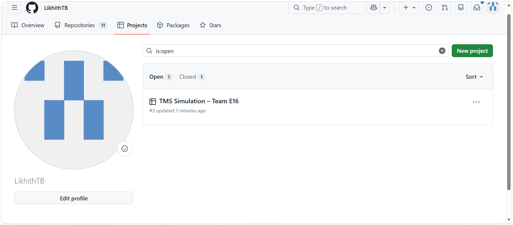
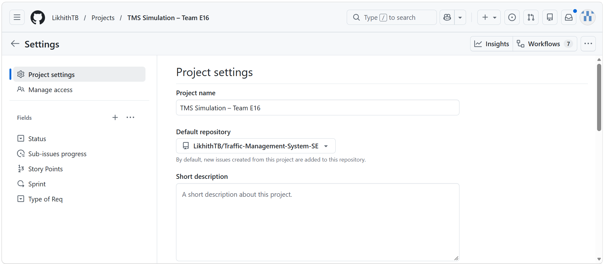
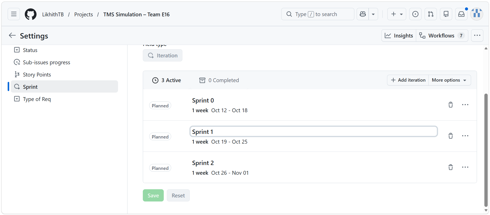
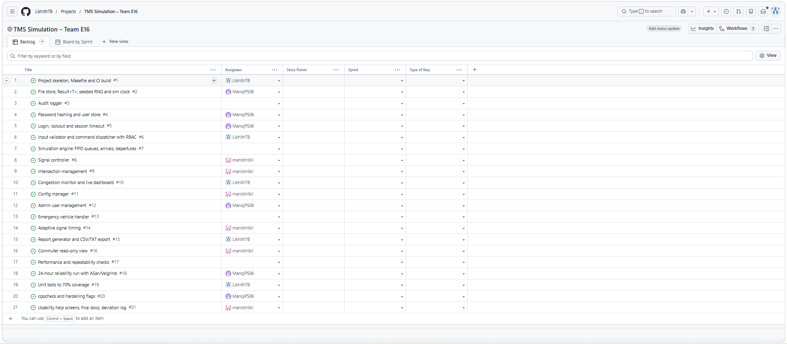
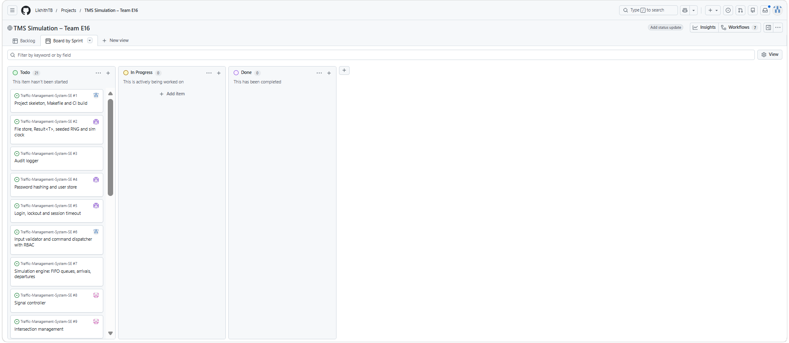
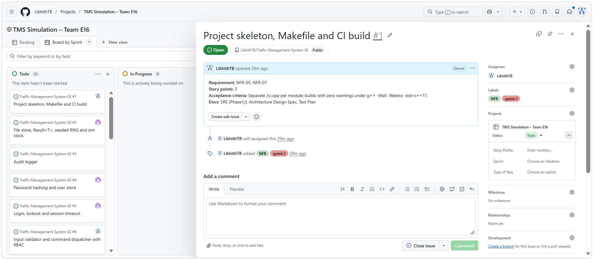
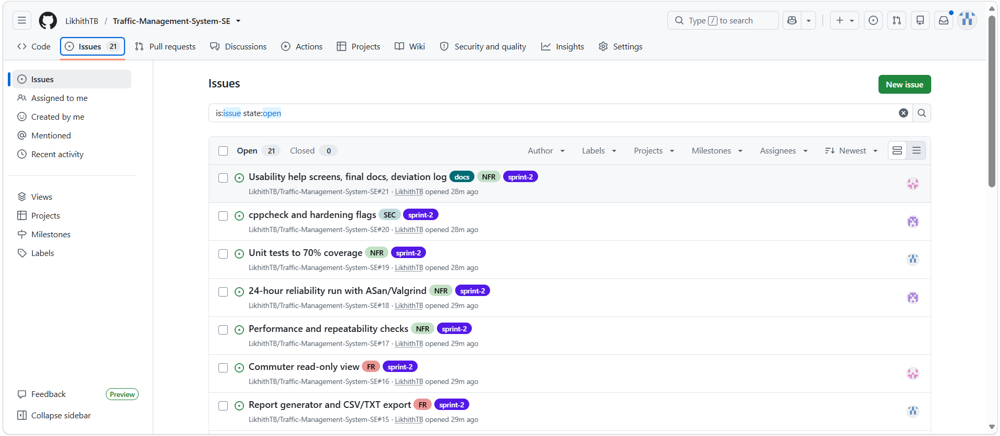
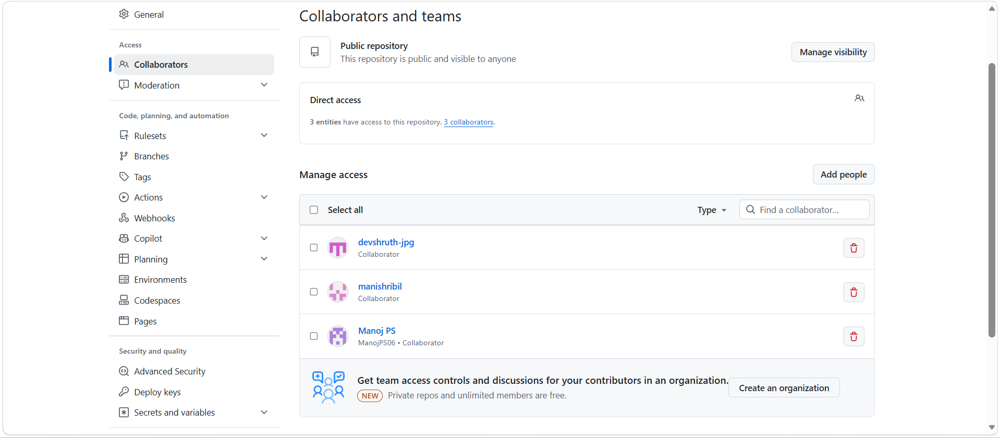
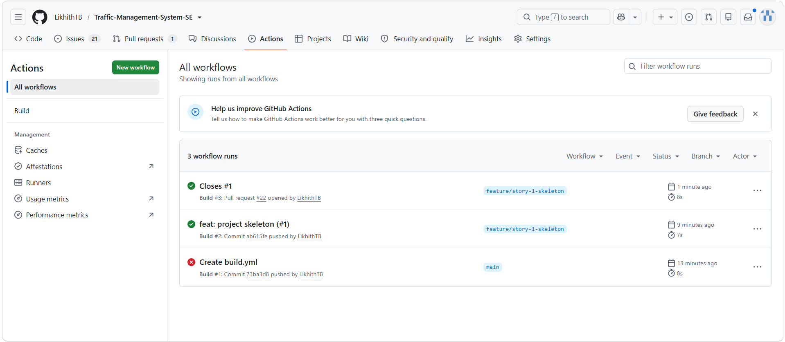

# Phase 2 – Backlog Creation & Sprint Plan

**Project board:** https://github.com/users/LikhithTB/projects/2
**Repository:** https://github.com/LikhithTB/Traffic-Management-System-SE

## 1. Summary
- 21 backlog items created from the FR, NFR and SEC requirements in the SRS (`Phase1/`)
- Each item is a GitHub Issue (#1–#21) linked to the GitHub Project, with story points, sprint, requirement type and an assignee
- Estimation: Fibonacci story points
- **Sprint 0 (dry run):** 12–18 Oct · **Sprint 1:** 19–25 Oct (work week 19–23) · **Sprint 2:** 26 Oct–1 Nov (work week 26–30)
- Sprint 1 = 50 points, Sprint 2 = 44 points

## 2. Team
| Member | GitHub |
|---|---|
| Likhith T Bommisetty | LikhithTB |
| Devashruth M | devshruth-jpg |
| Manish Bala | manishribil |
| Manoj PS | ManojPS06 |

## 3. Sprint 1 backlog (19–23 Oct)
| Issue | Story | Requirement | Pts | Owner |
|---|---|---|---|---|
| #1 | Project skeleton, Makefile and CI build | NFR-05, NFR-07 | 3 | Likhith |
| #2 | File store, Result<T>, seeded RNG and sim clock | FR-01, NFR-08 | 3 | Manoj |
| #3 | Audit logger | SEC-07, SEC-08 | 3 | Devashruth |
| #4 | Password hashing and user store | SEC-02, FR-07 | 5 | Manoj |
| #5 | Login, lockout and session timeout | SEC-01, SEC-03, SEC-04 | 5 | Manoj |
| #6 | Input validator and command dispatcher with RBAC | NFR-06, SEC-05, SEC-06 | 5 | Likhith |
| #7 | Simulation engine: FIFO queues, arrivals, departures | FR-01 | 8 | Devashruth |
| #8 | Signal controller | FR-02 | 5 | Manish |
| #9 | Intersection management | FR-08 | 5 | Manish |
| #10 | Congestion monitor and live dashboard | FR-03 | 5 | Likhith |
| #11 | Config manager | FR-05 | 3 | Manish |

## 4. Sprint 2 backlog (26–30 Oct)
| Issue | Story | Requirement | Pts | Owner |
|---|---|---|---|---|
| #12 | Admin user management | FR-07 | 5 | Manoj |
| #13 | Emergency vehicle handler | FR-04 | 8 | Devashruth |
| #14 | Adaptive signal timing | FR-09 | 5 | Manish |
| #15 | Report generator and CSV/TXT export | FR-06, SEC-08 | 5 | Likhith |
| #16 | Commuter read-only view | FR-10 | 3 | Manish |
| #17 | Performance and repeatability checks | NFR-01, NFR-02, NFR-08 | 3 | Devashruth |
| #18 | 24-hour reliability run with ASan/Valgrind | NFR-03 | 3 | Manoj |
| #19 | Unit tests to 70% coverage | NFR-05 | 5 | Likhith |
| #20 | cppcheck and hardening flags | SEC-06 | 2 | Manoj |
| #21 | Usability help screens, final docs, deviation log | NFR-04, docs | 3 | Manish |

## 5. Workflow
1. One branch per story (`feature/story-<n>-<name>`)
2. Pull Request with `Closes #<issue>`
3. Review and approval by the repo owner
4. Merge; GitHub Actions (`Build` workflow) compiles every push and PR with `g++ -Wall -Wextra -std=c++17`

Sprint 0 dry run: PR #22 (`feature/story-1-skeleton`) added the `src/main.cpp` skeleton. The first workflow run on `main` failed because `src/` did not exist yet; the run on the PR passed.

## 6. Screenshots
**Project created**

**Project fields (Story Points, Sprint, Type of Req) and default repository**

**Sprint iterations**

**Backlog table (21 items)**

**Board view**

**Issue detail (#1)**

**Issues list**

**Collaborators**

**GitHub Actions runs**

